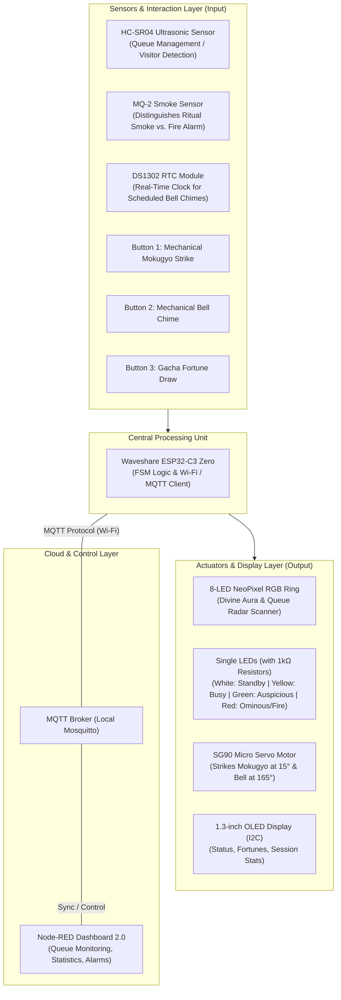

# Cyber Pagoda - Smart IoT Ritual & Queue Management System

> **Course:** IOT Apps Dev  
> **Development Platform:** PlatformIO / Arduino IDE  
> **Microcontroller:** Waveshare ESP32-C3 Zero  
> **Dashboard UI:** Node-RED Dashboard 2.0 (`@flowfuse/node-red-dashboard`)

---

## 1. Problem Statement & Practical Applicability

In modern life, more young people are turning to spiritual practices like online worship, believing it brings them luck in daily life. Meanwhile, sacred sites often face overcrowding issues during special occasions and festivals.To address both issues, this project introduces an interactive IoT-enabled worship station. It combines a gamified ritual experience for visitors with real-time crowd monitoring and management for venue administrators.

The **Cyber Pagoda** project addresses these challenges by offering:
* **Automated Queue Management:** Utilizes an ultrasonic distance sensor to regulate the flow of visitors sequentially (allowing only one person at a time on the platform, preventing congestion, the number 'one' here can be extended as the project growth, but now we decided it to be 1 in a time as a demo).
* **Merit Point System:** Gamifies the spiritual experience by tracking specific interactions (striking the Mokugyo, ringing the bell, offering incense) and calculating a total "Merit Score" for each session.
* **Digitized Traditional Rituals:** Combines physical multi-directional interactions (mechanical mokugyo striking, bell ringing, Gacha fortune-telling, and incense offerings) with real-time visual light feedback and authentic mechanical sound responses.
* **Real-time IoT Monitoring:** Synchronizes all session data, interaction statistics, and smoke/fire hazard alerts remotely via the MQTT protocol and a responsive **Node-RED Dashboard 2.0**.

---

## 2. System Architecture Block Diagram



---

## 3. Bill of Materials (BOM)

All hardware components are optimized for a compact, neat, and modular assembly:

| No. | Component / Device Name | Qty | Main Functional Role |
| :---: | :--- | :---: | :--- |
| 1 | **Waveshare ESP32-C3 Zero** | 1 | Central microcontroller, Wi-Fi connectivity, runs PlatformIO code |
| 2 | **1.3-inch OLED Display (I2C)** | 1 | Displays status UI, fortune results, and session statistics |
| 3 | **DS1302 RTC Module** | 1 | Provides real-time clock references for automated scheduled chimes |
| 4 | **HC-SR04 Ultrasonic Sensor** | 1 | Detects the presence of a 3D visitor model (Queue management) |
| 5 | **MQ-2 Smoke Sensor (Analog)** | 1 | Measures smoke concentration (distinguishes ritual smoke vs. fire accidents) |
| 6 | **SG90 Micro Servo Motor** | 1 | Dual mechanical actuator (sweeps to 15° for Mokugyo, 165° for bell) |
| 7 | **8-LED NeoPixel Ring (WS2812)** | 1 | Creates dynamic RGB divine aura lighting effects & radar scanning |
| 8 | **Single LEDs (White, Yellow, Green, Red)** | 1 each | Status indicators (each wired in series with a $1\text{k}\Omega$ current-limiting resistor) |
| 9 | **Push Buttons** | 3 | Button 1: Mokugyo; Button 2: Bell Chime; Button 3: Fortune Draw |
| 10 | **$1\text{k}\Omega$ Resistors** | 4+ | Current-limiting protection resistors for single LEDs |
| 11 | **Power Supply:** Type-C Cable & 5V Power Bank | 1 | Provides stable system power |

---

## 4. GPIO Pin Mapping on ESP32-C3 Zero

| Peripheral Device | ESP32-C3 Pin | Communication Standard | Detailed Wiring Notes |
| :--- | :---: | :---: | :--- |
## 4. GPIO Pin Mapping on Waveshare ESP32-C3-Zero

| Peripheral Device | ESP32-C3-Zero Pin | Physical Pin | Communication Standard | Detailed Wiring Notes |
| :--- | :---: | :---: | :---: | :--- |
| **Power Supply & Ground** | `5V`, `GND`, `3V3(OUT)` | Pin 1, 2, 3 | Power Rail | `5V` for Servo/NeoPixel/MQ-2/HC-SR04; `3V3(OUT)` for OLED & logic |
| **1.3" OLED Display** | `GP4 (SDA)`, `GP5 (SCL)` | Pin 8, Pin 9 | I2C | Shared I2C bus for UI rendering |
| **RTC Module** | `GP4 (SDA)`, `GP5 (SCL)` | Pin 8, Pin 9 | I2C | Shares hardware I2C bus (`GP4`/`GP5`) with OLED display |
| **Ultrasonic Sensor (Trig)** | `GP3` | Pin 7 | Digital Out | Transmits ultrasonic pulses for visitor positioning |
| **Ultrasonic Sensor (Echo)** | `GP1` | Pin 5 | Digital In | Receives reflected ultrasonic echo signals |
| **MQ-2 Smoke Sensor** | `GP2` | Pin 6 | Analog (ADC) | Reads analog voltage representing smoke concentration |
| **8-LED NeoPixel Ring** | `GP10` | Pin 14 | One-Wire (WS2812) | Main RGB aura control line (synced with onboard WS2812 `GP10 DIN`) |
| **SG90 Servo Motor** | `GP7` | Pin 11 | PWM | Controls mechanical sweep angles (90° → 15° / 165°) |
| **White Single LED** | `GP6` | Pin 10 | Digital Out | Active during Standby mode (Shrine open, via 1kΩ resistor) |
| **Yellow Single LED** | `GP21 (UART0 TX)` | Pin 18 | Digital Out | Active when platform is busy (Queue lock, via 1kΩ resistor) |
| **Green Single LED** | `GP0` | Pin 4 | Digital Out | Active on Auspicious fortunes (Major/Minor Good, via 1kΩ resistor) |
| **Red Single LED** | `GP20 (UART0 RX)` | Pin 17 | Digital Out | Active on Ominous fortunes or Smoke Fire Alarm (via 1kΩ resistor) |
| **Button 1 (Mokugyo)** | `GP8` | Pin 12 | Digital In (`PULLUP`) | Triggers mechanical Mokugyo sweep to 15° |
| **Button 2 (Bell Chime)** | `GP9` | Pin 13 | Digital In (`PULLUP`) | Triggers mechanical bell chime sweep to 165° |
| **Button 3 (Fortune Draw)** | `GP18 (USB DM)` | Pin 15 | Digital In (`PULLUP`) | Triggers random Gacha fortune drawing on OLED |

---

## 5. System Workflow & MQTT Protocol

### A. Queue Finite State Machine (FSM) Lifecycle
1. **Standby State:** Ultrasonic sensor measures distance $>60\text{ cm}$. **White LED lights up**, NeoPixel ring runs blue radar animation, and Servo rests statically at **90 degrees**. OLED displays: *"Shrine Open - Welcome Next Visitor"*.
2. **Session Active State:** Places a 3D visitor model within the $20 - 45\text{ cm}$ range. **White LED turns off, Yellow LED lights up** (locking the queue). User interacts with the station to accumulate Merit Points (+1 for each valid action):
   * **Button 1 (Mokugyo):** Servo sweeps 90° $\rightarrow$ **15°** $\rightarrow$ **90°**. **Merit Points +1**.
   * **Button 2 (Bell):** Servo sweeps 90° $\rightarrow$ **165°** $\rightarrow$ **90°**. **Merit Points +1**.
   * **MQ-2 Smoke Sensor (Incense):** Detects moderate smoke levels (ritual incense). **Merit Points +1** (includes a debounce timer to prevent spamming).
   * **Button 3 (Fortune):** Generates a random fortune, updates OLED, and lights up **Green LED** (Auspicious) or **Red LED** (Ominous).
3. **Checkout State:** Removes the visitor model to $>60\text{ cm}$. **Yellow LED turns off, White LED turns back on**. Summarizes session metrics (Total Merit Points, Fortune) and automatically pushes a JSON payload via MQTT to Node-RED.

### B. MQTT Topics Structure (Node-RED Dashboard 2.0)
- `temple/session/stat` *(ESP32 $\rightarrow$ Node-RED)*: Transmits summarized session telemetry data when a visitor leaves the platform.
  * **Payload Example:** `{"session_id": 102, "mokugyo": 3, "bell": 1, "incense": 1, "merit_points": 5, "fortune": "Major Good"}`
- `temple/alert/fire` *(ESP32 $\rightarrow$ Node-RED)*: Emergency alert triggered when MQ-2 smoke levels exceed safety thresholds (Flashes Red LED rapidly).
- `temple/control/bell` *(Node-RED $\rightarrow$ ESP32)*: Remote actuation command to ring the bell/Mokugyo via the Dashboard UI.

### B. MQTT Topics Structure (Node-RED Dashboard 2.0)
* `temple/session/stat` *(ESP32 $\rightarrow$ Node-RED)*: Transmits summarized session telemetry data when a visitor leaves the platform.
* `temple/alert/fire` *(ESP32 $\rightarrow$ Node-RED)*: Emergency alert triggered when MQ-2 smoke levels exceed safety thresholds (Flashes Red LED rapidly).
* `temple/control/bell` *(Node-RED $\rightarrow$ ESP32)*: Remote actuation command to ring the bell/Mokugyo via the Dashboard UI.

---

## 6. Local MQTT Broker Setup (Eclipse Mosquitto)

To ensure high stability during academic presentations without internet dependency:
1. Download and install **Eclipse Mosquitto** (Windows 64-bit).
2. Edit `mosquitto.conf` to enable external access and disable anonymous blocking:
   ```text
   listener 1883 0.0.0.0
   allow_anonymous true
   ```
3. Restart the **Mosquitto Broker** Windows Service. Get your PC's local IPv4 address via `ipconfig` in Command Prompt and configure it in your ESP32 firmware (`mqtt_server`).

---

## 7. Node-RED Dashboard 2.0 Configuration Guide

1. **Install Palette:** Go to Menu $\rightarrow$ *Manage Palette* $\rightarrow$ Install `@flowfuse/node-red-dashboard`.
2. **Create UI Pages & Groups:**
   * **Page:** `Cyber Pagoda`
   * **Group 1:** `System Monitoring` (Giám sát hệ thống & Điểm công đức)
   * **Group 2:** `Control & Alarms` (Điều khiển và cảnh báo)
3. **Flow Structure:**
   * **Session Statistics:** `mqtt in` (Topic: `temple/session/stat`, Output: Parsed JSON) $\rightarrow$ `ui text` (Display format: `Total Merit: {{msg.payload.merit_points}} | Fortune: {{msg.payload.fortune}}`).
   * **Detailed Actions:** Add `ui gauge` or `ui text` nodes mapped to `{{msg.payload.mokugyo}}`, `{{msg.payload.bell}}`, and `{{msg.payload.incense}}` for detailed interaction tracking.
   * **Fire Alarm:** `mqtt in` (Topic: `temple/alert/fire`) $\rightarrow$ `switch` (`msg.payload.alert == true`) $\rightarrow$ `ui notification` (Top Right, Negative color).
   * **Remote Bell Control:** `ui button` (Payload JSON: `{"command": "ring_bell"}`) $\rightarrow$ `mqtt out` (Topic: `temple/control/bell`).

---

## 8. Expected Hardware Preview & Assembly Diagram
